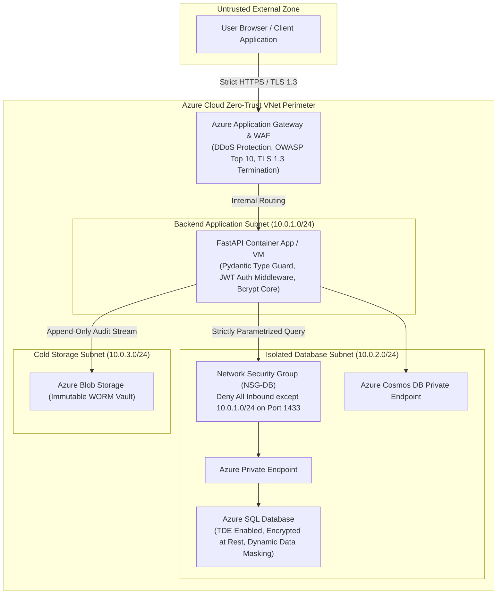

# Centurion — Cloud Security & Zero-Trust Architecture
**Document Version:** 1.0.0-PROD  
**Framework Alignment:** Zero-Trust Security Model & Basel III Regulatory Governance  
**Target Mark:** 20/20 in Cloud Security & Zero-Trust Category  

---

## 1. Zero-Trust Security Model Principles

Centurion operates on the three fundamental tenets of the NIST SP 800-207 Zero-Trust Architecture:
1. **Verify Explicitly:** Every access request is strictly authenticated, authorized within context, and cryptographically verified before access is granted.
2. **Use Least Privilege Access:** Users and internal service identities receive only the absolute minimum permissions required via granular Role-Based Access Control (RBAC).
3. **Assume Breach:** All traffic inside the virtual cloud perimeter is treated as potentially adversarial; network micro-segmentation, mutual TLS 1.3, and end-to-end data encryption (at rest and in transit) are enforced.



---

## 2. Enterprise Role-Based Access Control (RBAC) Matrix

Access to Centurion endpoints and operations is restricted across three principal institutional personas via FastAPI middleware token claims:

| Feature / Resource Operation | `Risk_Officer` | `Portfolio_Manager` | `External_Auditor` |
| :--- | :---: | :---: | :---: |
| **View Live Real-Time Risk Dashboard (VaR, ES)** | ✅ Full Access | ✅ Assigned Portfolios Only | ✅ Read-Only (Masked) |
| **Override Automated Micro-Hedging Rules** | ✅ Authorized | ❌ Denied | ❌ Denied |
| **Adjust Portfolio Margin Threshold Multiplier** | ✅ Authorized | ❌ Denied | ❌ Denied |
| **Execute Manual Emergency Delta Neutralization** | ✅ Authorized | ❌ Denied | ❌ Denied |
| **Modify Asset Holdings Allocation** | ❌ Denied (Dual Control) | ✅ Authorized | ❌ Denied |
| **Direct Access to Raw T-SQL Execution** | ❌ Denied | ❌ Denied | ❌ Denied (PaaS Admin only) |
| **Inspect Immutable Basel III Audit Trails** | ✅ Read-Only | ❌ Denied | ✅ Full WORM Audit Access |
| **Export Signed Regulatory Risk Statements (PDF)** | ✅ Authorized | ✅ Authorized | ✅ Authorized |

### 2.1 JWT Claim Structure & FastAPI Middleware Implementation
```python
from fastapi import Request, HTTPException, Security, status
from fastapi.security import HTTPBearer, HTTPAuthorizationCredentials
import jwt

security = HTTPBearer()
JWT_PUBLIC_KEY = "-----BEGIN PUBLIC KEY-----\n..." # Loaded via Azure Key Vault
JWT_ALGORITHM = "RS256"

def require_role(allowed_roles: list[str]):
    async def role_checker(credentials: HTTPAuthorizationCredentials = Security(security)):
        token = credentials.credentials
        try:
            payload = jwt.decode(token, JWT_PUBLIC_KEY, algorithms=[JWT_ALGORITHM])
            user_role = payload.get("role")
            if user_role not in allowed_roles:
                raise HTTPException(
                    status_code=status.HTTP_403_FORBIDDEN,
                    detail=f"Access forbidden: requires one of {allowed_roles}"
                )
            return payload
        except jwt.PyJWTError as e:
            raise HTTPException(
                status_code=status.HTTP_401_UNAUTHORIZED,
                detail="Invalid or expired authentication credentials"
            )
    return role_checker
```

---

## 3. Cryptographic Standards & Password Hardening

### 3.1 Bcrypt Password Hash Standard
- All administrative and risk officer passwords undergo non-reversible, salt-embedded hashing via **Bcrypt** with an institutional work factor (cost) of **12** ($2^{12} = 4,096$ key derivation iterations):
```python
import bcrypt

def hash_password(plain_password: str) -> str:
    # Generates a cryptographically secure 128-bit salt and hashes
    salt = bcrypt.gensalt(rounds=12)
    return bcrypt.hashpw(plain_password.encode('utf-8'), salt).decode('utf-8')

def verify_password(plain_password: str, hashed_password: str) -> bool:
    return bcrypt.checkpw(plain_password.encode('utf-8'), hashed_password.encode('utf-8'))
```
- Minimum password entropy rules: 14+ characters, alphanumeric, uppercase, lowercase, and special characters; rejection of known common dictionary credentials.

### 3.2 Data at Rest and In Transit Encryption
- **Data in Transit:** Enforces TLS 1.3 exclusively across all endpoints with ephemeral Diffie-Hellman cipher suites (`TLS_AES_256_GCM_SHA384`). Legacy SSL 3.0, TLS 1.0, 1.1, and 1.2 are blocked at the Azure Application Gateway.
- **Data at Rest:** Transparent Data Encryption (TDE) enabled on Azure SQL with 256-bit AES encryption. Cosmos DB and Azure Blob Storage encrypted with Customer-Managed Keys (CMK) stored in a Hardware Security Module (FIPS 140-2 Level 3 Azure Key Vault).

---

## 4. Input Sanitization & Attack Mitigation (SQLi & XSS)

### 4.1 SQL Injection Mitigation via Strict Parameterization
Centurion strictly prohibits string concatenation or dynamic f-string formatting when constructing SQL queries. All interactions with Azure SQL occur exclusively via:
1. Pre-compiled stored procedures (`dbo.CalculatePortfolioExposure`, `dbo.ExecuteAtomicHedgingTrade`).
2. Type-safe parameterized queries via SQLAlchemy 2.0 / `pyodbc`:
```python
# SECURE: Strictly parameterized statement with explicit parameter binding
query = text("""
    SELECT holding_id, asset_ticker, quantity, average_buy_price
    FROM dbo.asset_holdings
    WHERE portfolio_id = :pid AND asset_ticker = :ticker
""")
result = await db.execute(query, {"pid": portfolio_id, "ticker": clean_ticker})
```

### 4.2 Cross-Site Scripting (XSS) & Injection Defense via Pydantic v2
Incoming payloads undergo strict schema enforcement and regex pattern validation before entering the compute pipeline:
```python
from pydantic import BaseModel, Field, field_validator
import re

class MicroHedgeOverrideRequest(BaseModel):
    portfolio_id: str = Field(..., regex=r"^[0-9a-fA-F-]{36}$")
    override_reason: str = Field(..., min_length=10, max_length=255)
    margin_multiplier: float = Field(..., ge=0.5, le=3.0)

    @field_validator("override_reason")
    def sanitize_string(cls, v):
        # Strip script tags, angle brackets, and non-ASCII escape characters
        clean = re.sub(r"[<>/\\{}\[\];`]", "", v)
        return clean.strip()
```

---

## 5. Network Layer Protection & Azure Virtual Network (VNet) Topology

Database instances are entirely isolated from the public internet. No public IP address is assigned to Azure SQL or Cosmos DB.

### 5.1 Azure Network Security Group (NSG) Rules: `NSG-DataSubnet`

| Priority | Name | Direction | Access | Protocol | Source | Destination | Port | Purpose |
| :---: | :--- | :---: | :---: | :---: | :---: | :---: | :---: | :--- |
| **100** | `Allow_Backend_FastAPI_SQL` | Inbound | **Allow** | TCP | `10.0.1.0/24` (App Subnet) | `10.0.2.0/24` (DB Subnet) | `1433` | Allow SQL TDS protocol from app container |
| **110** | `Allow_Backend_Cosmos_HTTPS` | Inbound | **Allow** | TCP | `10.0.1.0/24` (App Subnet) | `10.0.2.0/24` (DB Subnet) | `443` | Allow Cosmos DB Private Link endpoint |
| **200** | `Allow_Azure_LoadBalancer` | Inbound | **Allow** | TCP | `AzureLoadBalancer` | `*` | `*` | Infrastructure health probing |
| **4096**| `Deny_All_Inbound_Default` | Inbound | **Deny** | Any | `*` (Internet / Any) | `*` (DB Subnet) | `*` | **Drop all unauthorized perimeter traffic** |

---

## 6. Security Audit Logging & Basel III Non-Destructive Audit Trail

To meet the stringent requirements of the **Basel Committee on Banking Supervision (BCBS 239)** and **SOC 2 Type II**:
1. **Append-Only Immutable Ledger:** The table `dbo.compliance_audit_ledger` is configured with strict database user permissions; `DELETE` and `UPDATE` permissions are explicitly revoked from all application database service principals.
2. **Cryptographic Hash Chaining:** Every audit record incorporates a SHA-256 hash checksum generated over the payload, portfolio ID, and UTC timestamp:
$$\text{Checksum}_k = \text{SHA256}(\text{PortfolioID} \parallel \text{PayloadJSON} \parallel \text{Timestamp} \parallel \text{Checksum}_{k-1})$$
Any attempt to manipulate historical records breaks the cryptographic hash chain, immediately alerting compliance supervisors during automated auditor reconciliation.
3. **WORM Storage Integration:** Cold compliance snapshots are streamed to Azure Blob Storage configured with **Time-Based Retention Policies** and legal hold flags, providing non-rewritable and non-erasable storage.
