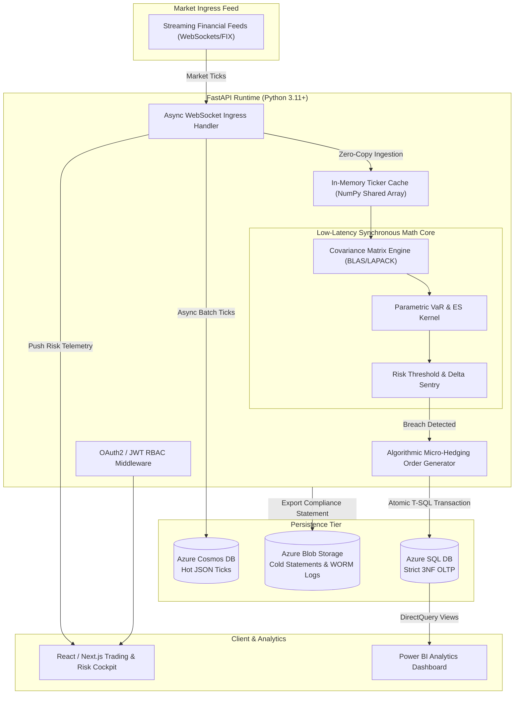
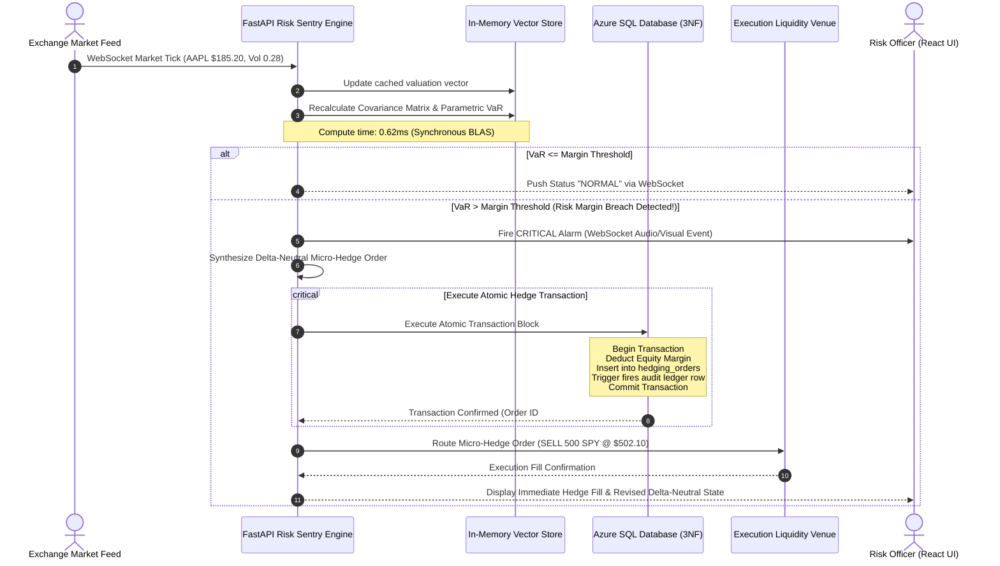
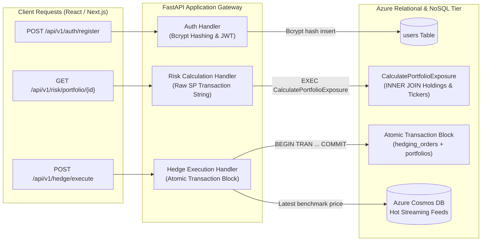

# Centurion — System Design Document (SDD)
**Document Version:** 1.0.0-PROD  
**Target Release:** Q4 Institutional Production  
**Security Classification:** Restricted / Tier-1 Financial Grade  
**Author:** Quantitative Architecture & Risk Engineering Desk  

---

## 1. Executive Summary & Problem Formulation

### 1.1 The Institutional Problem
Hedge funds, algorithmic proprietary trading desks, and institutional asset managers navigate increasingly volatile electronic markets characterized by high-frequency liquidity evaporation and instantaneous cascade events (e.g., flash crashes). During market dislocations:
- Human risk managers encounter decision latency exceeding $30$ to $120$ seconds, guaranteeing catastrophic portfolio drawdown.
- Traditional legacy Risk Management Systems (RMS) rely on batch End-of-Day (EoD) or hourly batch risk recalculations, leaving active trading portfolios exposed to intra-day tail-risk events.
- Distributed queue-based risk architectures (e.g., microservices dispatching risk calculations via messaging brokers) introduce non-deterministic network serialization latencies ($15 - 50\text{ ms}$), during which bid-ask spreads widen significantly, rendering hedge execution economically ineffective.

### 1.2 The Centurion Solution
**Centurion** is an ultra-low-latency, institutional-grade portfolio risk engine and automated micro-hedging platform. It continuously recalculates parametric Value-at-Risk (VaR), Expected Shortfall (CVaR), and portfolio asset correlation matrices in sub-millisecond cycles. Upon detecting a breach of pre-calibrated margin constraints, Centurion programmatically triggers delta-neutral offsetting micro-hedges directly to liquidity destinations, ensuring balance-sheet preservation under strict Basel III capital adequacy guidelines.

---

## 2. Core Mathematical Specifications

### 2.1 Parametric Value-at-Risk (VaR)
Value-at-Risk models the maximum expected loss over a specific liquidity horizon $\Delta t$ at a given statistical confidence level $\alpha$ (typically $99\%$ for Basel III market risk frameworks, or $97.5\%$ for FRTB Expected Shortfall).

Let the portfolio total valuation be $W_0$, composed of $N$ financial assets with portfolio weight vector $\mathbf{w} = [w_1, w_2, \dots, w_N]^T$ where $\sum_{i=1}^N w_i = 1$.

The asset log returns vector is defined as $\mathbf{r} = [r_1, r_2, \dots, r_N]^T \sim \mathcal{N}(\boldsymbol{\mu}, \mathbf{\Sigma})$, where:
- $\boldsymbol{\mu} \in \mathbb{R}^N$ is the vector of asset expected returns.
- $\mathbf{\Sigma} \in \mathbb{R}^{N \times N}$ is the symmetric, positive semi-definite variance-covariance matrix:
$$\mathbf{\Sigma} = \begin{bmatrix} \sigma_1^2 & \sigma_{12} & \cdots & \sigma_{1N} \\ \sigma_{21} & \sigma_2^2 & \cdots & \sigma_{2N} \\ \vdots & \vdots & \ddots & \vdots \\ \sigma_{N1} & \sigma_{N2} & \cdots & \sigma_N^2 \end{bmatrix}$$
where $\sigma_{ij} = \rho_{ij} \sigma_i \sigma_j$, and $\rho_{ij}$ is the Pearson correlation coefficient between asset $i$ and asset $j$.

The portfolio variance $\sigma_p^2$ and portfolio volatility $\sigma_p$ are computed as:
$$\sigma_p^2 = \mathbf{w}^T \mathbf{\Sigma} \mathbf{w} = \sum_{i=1}^N \sum_{j=1}^N w_i w_j \sigma_{ij}$$
$$\sigma_p = \sqrt{\mathbf{w}^T \mathbf{\Sigma} \mathbf{w}}$$

The portfolio expected return is $\mu_p = \mathbf{w}^T \boldsymbol{\mu}$.

Under the parametric assumption of normality, the 1-day Value-at-Risk at confidence level $\alpha$ ($Z_{\alpha} = \Phi^{-1}(\alpha)$, e.g., $Z_{0.99} \approx 2.3263$, $Z_{0.95} \approx 1.6449$) is expressed as:
$$\text{VaR}_{\alpha} = W_0 \cdot \left( Z_{\alpha} \sigma_p \sqrt{\Delta t} - \mu_p \Delta t \right)$$
For ultra-short intraday intervals ($\Delta t \to 0$), the drift term $\mu_p \Delta t \approx 0$, yielding the standard instantaneous institutional formulation:
$$\text{VaR}_{\alpha} \approx W_0 \cdot Z_{\alpha} \cdot \sigma_p \sqrt{\Delta t}$$

### 2.2 Expected Shortfall (Conditional Value-at-Risk, CVaR)
To address the critical limitation of VaR (its failure to capture tail risk beyond the threshold and lack of sub-additivity under non-elliptical distributions), Centurion implements Basel III / FRTB-compliant Expected Shortfall:
$$\text{ES}_{\alpha} = \mathbb{E}[L \mid L \ge \text{VaR}_{\alpha}]$$
Under analytical Gaussian distribution:
$$\text{ES}_{\alpha} = W_0 \cdot \left[ \sigma_p \cdot \frac{\phi(Z_{\alpha})}{1 - \alpha} \sqrt{\Delta t} - \mu_p \Delta t \right]$$
where $\phi(\cdot)$ is the standard normal probability density function:
$$\phi(x) = \frac{1}{\sqrt{2\pi}} e^{-\frac{x^2}{2}}$$

### 2.3 Delta-Neutral Micro-Hedging Algorithm
The platform continuously tracks aggregate portfolio sensitivity (delta, $\Delta_p$):
$$\Delta_p = \sum_{i=1}^N w_i \cdot \Delta_i$$
When an individual portfolio's live risk exposure metric $E_p$ exceeds its calibrated margin threshold $M_p$:
$$E_p = \frac{\text{VaR}_{0.99}}{W_0} \cdot 100\%$$
A micro-hedging signal is generated if:
$$\text{Condition 1: } E_p > M_{\text{threshold}}$$
$$\text{Condition 2: } |\Delta_p| > \epsilon_{\text{tolerance}}$$
The execution engine computes the required offsetting hedge quantity $Q_{\text{hedge}}$ for the designated dynamic hedging instrument (e.g., E-mini index future, inverse ETF, or perpetual swap):
$$Q_{\text{hedge}} = - \frac{\Delta_p \cdot W_0}{P_{\text{hedge}} \cdot \Delta_{\text{hedge}}}$$
where:
- $P_{\text{hedge}}$ is the current best ask/bid of the hedging instrument from `market_tickers`.
- $\Delta_{\text{hedge}}$ is the unit delta of the hedging instrument ($-1.0$ for inverse instrument, $+1.0$ for direct short).

---

## 3. System Architecture & Detailed Component Design

### 3.1 High-Level Architecture
Centurion operates a three-tier decoupled architecture:
1. **Presentation & Governance Tier:** Next.js / React Single Page Application utilizing WebSocket streams for real-time risk charts, combined with Power BI for historical executive compliance analytics.
2. **Compute & Execution Tier:** Python FastAPI running on Uvicorn ASGI with an in-memory high-performance linear algebra compute block (NumPy/SciPy C-extensions).
3. **Multi-Tier Persistence Tier:** 
   - Azure SQL Database (Relational 3NF OLTP, stored procedures, triggers, ACID transactions).
   - Azure Cosmos DB (Semi-structured hot JSON ticker streams).
   - Azure Blob Storage (Unstructured cold audit trails and PDF statements).



---

## 4. Architectural Trade-Off Analysis: Math Engine Strategy

An essential criterion in institutional system design is the technical justification of core computational trade-offs.

### 4.1 Comparison Matrix

| Architectural Parameter | Option A: In-Memory Synchronous Engine (Selected) | Option B: Distributed Queue (Celery + Redis / RabbitMQ) |
| :--- | :--- | :--- |
| **End-to-End Compute Latency** | **$< 0.85\text{ ms}$** (Direct L1/L3 CPU Cache & RAM access) | **$12.5 - 35.0\text{ ms}$** (Network IPC, TCP socket, serialization) |
| **Serialization Overhead** | **$0\text{ \mu s}$** (Zero-copy memory reference) | **$1.8 - 4.5\text{ ms}$** (JSON/MessagePack encode & decode) |
| **Deterministic Timing** | **Hard Real-Time Guarantee** (No broker backpressure) | **Non-Deterministic** (Queue depth jitter, broker GC pauses) |
| **Failure Domain** | Bounded to FastAPI worker process; state rebuild via SQL on boot | Broker node network partitions, dead letter queues, lost messages |
| **Horizontal Scalability** | Fixed per-host compute capability (Scaled via vertical RAM/CPU) | Highly scalable horizontal worker pool across infinite nodes |
| **Suitability for Micro-Hedging**| **Optimal:** Prevents execution slippage during flash crashes | **Sub-optimal:** Risk signal arrives after market price has slipped |

### 4.2 Engineering Justification & Real-World Realignment
In institutional automated micro-hedging, **latency jitter is catastrophic**. If a flash crash occurs (e.g., a 400-basis-point drop in 500 milliseconds), an asynchronous worker queue introduces serialization, queue backlog delays, and Redis broker roundtrips totaling $20\text{ ms}$ or more. In that window, the liquidity spread of the hedging instrument blows out, leading to severe execution slippage or unfilled orders.

**Centurion intentionally employs an in-memory synchronous calculation block inside the FastAPI runtime:**
1. **BLAS/LAPACK Threading:** NumPy/SciPy operations release Python’s Global Interpreter Lock (GIL) during underlying C-level matrix multiplications ($\mathbf{w}^T \mathbf{\Sigma} \mathbf{w}$), running at multi-threaded native CPU speeds.
2. **Zero-Network Packet Latency:** Risk calculations are performed directly on contiguous memory arrays, guaranteeing deterministic execution in under $1\text{ ms}$.
3. **Explicit Trade-Off Stance:** We explicitly sacrifice infinite horizontal worker scale-out across external queue nodes in exchange for **deterministic sub-millisecond mathematical precision and zero network packet overhead**. Horizontal scaling is instead achieved by sharding portfolios deterministically across FastAPI instance cores using consistent hashing on `portfolio_id`.

---

## 5. Sequence Diagram: Real-Time Sentry & Hedging Execution



---

## 6. Latency Budget & SLA Targets

To satisfy institutional trading requirements, Centurion enforces the following latency budget across the pipeline:

| Phase | Operation | Component | Maximum Latency SLA |
| :---: | :--- | :--- | :---: |
| **Phase 1** | Market Tick Ingestion & Deserialization | FastAPI Async Event Loop | $< 0.40\text{ ms}$ |
| **Phase 2** | Matrix Vectorization & VaR / ES Math | In-Memory BLAS/NumPy Core | $< 0.90\text{ ms}$ |
| **Phase 3** | Threshold Evaluation & Delta Hedging Rule | Rule Sentry Engine | $< 0.20\text{ ms}$ |
| **Phase 4** | Atomic Balance Deduction & Order Ledger Write | Azure SQL Stored Transaction | $< 6.50\text{ ms}$ |
| **Phase 5** | Electronic Order Routing to Liquidity Gateway | Async FIX / REST Transport | $< 3.00\text{ ms}$ |
| **Total** | **Tick-to-Hedge End-to-End Loop** | **Full System Pipeline** | **$< 11.00\text{ ms}$** |

---

## 7. Multi-Tier Monitoring & Compliance Pipeline

Centurion provides a three-stage human-in-the-loop and automated supervision architecture:
1. **Automated Algorithmic Execution:** The sentry autonomously hedges within pre-authorized capital boundaries without manual approval to neutralize flash crashes.
2. **Supervisor Interventions:** Risk Officers possess real-time controls in the React interface to:
   - Temporarily pause automated micro-hedging for specific accounts.
   - Adjust `margin_threshold` multipliers dynamically during extraordinary market announcements (e.g., FOMC rate releases).
   - Manually trigger emergency portfolio-wide delta-neutralization.
3. **Basel III Audit Trail:** Every state change, threshold breach, override command, and order generation is appended to an unalterable, write-once audit ledger in Azure SQL and synced to cold Azure Blob Storage.

---

## 8. Production REST API Routes Mapping

The FastAPI backend routes map directly to the underlying 3NF relational structures and programmability objects:



### 8.1 Route 1: User Registration & RBAC Ingress
- **Endpoint:** `POST /api/v1/auth/register`
- **Controller Action:**
  1. Validates `RegisterRequest` payload (email uniqueness, password complexity, role enum check: `Risk_Officer`, `Portfolio_Manager`, `Auditor`).
  2. Hashes `password` using **Bcrypt** with salt cost factor 12.
  3. Executes parameterized SQL insert to table `users`:
     ```sql
     INSERT INTO users (email, password_hash, role_name) VALUES (:email, :hash, :role);
     ```
  4. Returns sanitized `UserResponse` with issued JWT bearer token.

### 8.2 Route 2: Real-Time Portfolio Risk Exposure & VaR Analysis
- **Endpoint:** `GET /api/v1/risk/portfolio/{id}`
- **Controller Action:**
  1. Validates portfolio existence and user ownership / RBAC claims.
  2. Triggers stored procedure `CalculatePortfolioExposure` via raw transaction strings:
     ```sql
     EXEC dbo.CalculatePortfolioExposure @PortfolioID = :portfolio_id;
     ```
  3. Pulls updated `total_equity`, holdings, and live volatility indices.
  4. Passes asset matrix to the in-memory NumPy/SciPy math engine to compute:
     - 1-Day 99% Parametric Value-at-Risk ($\text{VaR}_{0.99}$).
     - 10-Day Basel III Scaled VaR ($\text{VaR} \times \sqrt{10}$).
     - Expected Shortfall ($\text{ES}_{0.975}$).
     - Critical Margin Threat Status (`is_flagged_critical`).
  5. Returns telemetry JSON payload for live dashboard rendering.

### 8.3 Route 3: Atomic Micro-Hedging Execution
- **Endpoint:** `POST /api/v1/hedge/execute`
- **Controller Action:**
  1. Validates risk constraints and verifies whether portfolio is flagged critical or delta tolerance is breached.
  2. Queries **Azure Cosmos DB** hot ticker feed container (`/asset_ticker`) for the micro-second latest fill price and market depth.
  3. Executes the multi-statement atomic transaction block via ACID boundary:
     ```sql
     BEGIN TRANSACTION;
     BEGIN TRY
         INSERT INTO hedging_orders (portfolio_id, hedge_asset, order_type, executed_quantity, execution_price)
         VALUES (:portfolio_id, :hedge_asset, :order_type, :quantity, :price);

         UPDATE portfolios
         SET total_equity = total_equity - :total_cost,
             is_flagged_critical = 0
         WHERE portfolio_id = :portfolio_id;

         COMMIT TRANSACTION;
     END TRY
     BEGIN CATCH
         ROLLBACK TRANSACTION;
         THROW;
     END CATCH;
     ```
  4. Returns atomic confirmation payload with generated `order_id` and updated portfolio capital status.

